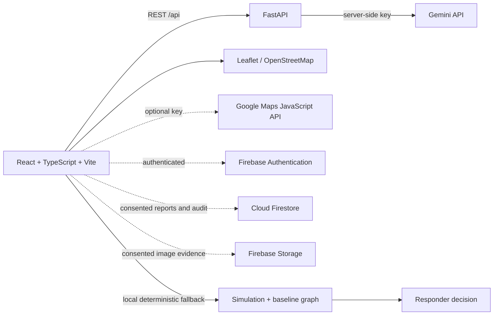

# SanjeevaniGrid AI

**Predict the cutoff. Keep care reachable.**

SanjeevaniGrid AI is a decision-support prototype for rural healthcare access during floods. It demonstrates how road-risk estimates, citizen reports, image review, voice capture, facility routing and responder decisions can fit into one human-verified workflow. It is not an emergency service and does not represent live emergency intelligence.

The product direction and sample rescue journey follow the attached project deck: predict access loss, gather local evidence, reroute to reachable care, then leave the decision with a responder.

## Run locally

Requirements: Node.js 20.19+ and Python 3.11+.

```powershell
npm install
npm run dev
```

Open the Vite URL printed by the command. The frontend runs without API keys using its deterministic demo scenario and local fallbacks.

To run the FastAPI service in a second terminal:

```powershell
py -m venv backend/.venv
backend/.venv/Scripts/Activate.ps1
pip install -r backend/requirements.txt
uvicorn app.main:app --reload --app-dir backend
```

Vite proxies `/api` to `http://127.0.0.1:8000`. Copy `.env.example` to `.env.local` for frontend settings and put server-only values in the backend process environment. Do not put `GEMINI_API_KEY` in a `VITE_` variable.

## How to demonstrate SanjeevaniGrid AI in 90 seconds

1. Open **Command Centre** and point out the simulation label, three sample villages, two sample facilities and the illustrative road graph.
2. Press **Play 90-sec demo**. The timeline advances every 12 seconds through rising water, a citizen road report, a seeded ProofCam review, a CareCutoff estimate, an alternate route and responder review.
3. Open **CareCutoff AI** to show the rule-based baseline, assumptions and scenario slider. Explain that the number is a simulation estimate, not an ML prediction.
4. Open **ProofCam**. Use **Show sample result** to demonstrate human confirmation without pretending a missing Gemini key analyzed an image. For live analysis, select a consented image and configure the backend key.
5. Open **VoiceSOS**. Load the Hindi example, structure it locally or consent to send the transcript to the configured Gemini service, inspect every field, then consent to add it to the demo queue.
6. Open **CareRoute** to compare facilities. The graph reweights risky roads and excludes the critical bridge at the “Alternative route found” stage.
7. Open **Responder review**, enter the simulated responder workspace, add a note, and approve the route recommendation. This completes the timeline.
8. Use **Reset simulation** to return to normal conditions.

The auto-run reaches responder review in about 72 seconds and waits for a human approval. The remaining time is for the judge to inspect the recommendation and approve it.

## Product modules

- **Command Centre:** interactive Leaflet/OpenStreetMap map by default; Google Maps JavaScript API when a key is configured; metrics, chart, status table and simulation timeline.
- **CareCutoff AI:** deterministic baseline estimate using a scenario stage, road vulnerability, critical-link exposure and alternate-route availability. Its risk factors and confidence are shown.
- **ProofCam:** consented image upload, preview, server-side Gemini multimodal endpoint and human confirm/reject flow. A seeded sample result is visually labeled and is not derived from an uploaded image.
- **VoiceSOS:** browser speech recognition where supported, text fallback, Hindi/English/Assamese language selection, explicit location confirmation and reviewable structured fields. Local extraction is keyword-based; it is not diagnosis or clinical triage.
- **CareRoute:** Dijkstra-style shortest-path search over the sample road graph, with distance, risk penalty, bridge closure and facility availability in the objective.
- **Sanjeevani Assistant:** answers from the current application data and cites evidence IDs. When Gemini is missing, local rules answer a small set of questions. Free-text emergency reports are not sent to this assistant; only aggregate report counts and sample scenario records are sent when Gemini is configured.
- **Responder review:** role check from the Firebase `users/{uid}` document, Firestore action audit and optional live citizen-report subscription. The demo workspace is explicitly simulated and is available without registration.

## Integrations and data labels

| Capability | Current behavior | What makes it live |
|---|---|---|
| Gemini | FastAPI endpoints return a clear unavailable response when no key is configured. UI then uses a disclosed sample or local fallback. | Set `GEMINI_API_KEY` on the backend and `GEMINI_MODEL` as needed. The backend uses the official Google Gen AI Python SDK and JSON-schema output. |
| Firebase Authentication | Optional email/password sign-in for citizen sharing and responder review; responder role is read from `users/{uid}`. | Configure the Firebase web values and enable Email/Password in Firebase Authentication. Provision accounts and responder role documents administratively. |
| Cloud Firestore | Consent-based voice reports can be written by an authenticated user. Responders subscribe to citizen reports and action history. | Deploy the included Firestore rules and create the database. |
| Firebase Storage | A consented image is stored only when Firebase Storage and an authenticated user are available. | Configure the Storage bucket and deploy `storage.rules`. Images are limited to JPEG/PNG/WebP and 8 MB. |
| Google Maps | Optional map layer with scenario markers and road overlays. | Set `VITE_GOOGLE_MAPS_API_KEY` and enable Maps JavaScript API. Without it, Leaflet + OpenStreetMap renders the same scenario graph. |
| Flood, road and facility feeds | Not connected. | Integrate authoritative feeds and validate coverage, freshness and operational ownership before using outside a demo. |

The sample geography is fictional and illustrative. Every dashboard count, hospital state, road state, event, location and route distance in the default demo is sample data. `SIMULATION`, `DEMO SEED`, and `LIVE` labels distinguish simulated and authenticated citizen-submitted reports.

## Configuration

Copy `.env.example` to `.env.local` for Vite settings. Frontend Firebase values are project configuration, not private secrets. Configure the backend environment separately:

```text
GEMINI_API_KEY=...                 # backend only
GEMINI_MODEL=gemini-3.8-flash
FIREBASE_PROJECT_ID=...            # enables Firebase ID-token enforcement in the API
CORS_ORIGINS=https://your-host.example
```

If `FIREBASE_PROJECT_ID` is set, the API verifies Firebase ID tokens using Application Default Credentials. If it is omitted, endpoints remain available for a local judge demo and use the per-process rate limiter. The in-memory limiter is for the MVP only; use a shared gateway limiter for production.

To enable the frontend integrations, set the corresponding `VITE_FIREBASE_*` values. Sign in from **VoiceSOS** to submit consented reports to Firestore, or from **Responder review** to take responder actions. The `users/{uid}` document must have `role: "responder"` for responder actions; user roles must be provisioned outside the client.

## Backend API

- `GET /api/health` — reports service and Gemini configuration state without exposing secrets.
- `POST /api/analyze-image` — accepts JPEG/PNG/WebP up to 8 MB, validates file signature, analyzes image bytes in memory and returns a human-review-required JSON result.
- `POST /api/extract-report` — extracts only caller-stated fields from a bounded transcript; the server creates the timestamp.
- `POST /api/assistant` — accepts a strict schema containing scenario values, aggregate queue counts, sample villages and sample facilities; raw report text is excluded.

The API does not write uploaded images to local disk. AI requests are rate-limited per process, and return explicit errors for missing keys or invalid model output. Production deployments still need monitoring, a shared rate limiter, abuse controls, data-retention policy and operational authentication review.

## Architecture



### Repository layout

```text
src/
  components/       map and grounded assistant
  domain/           typed scenario, baseline risk model and route graph
  pages/             landing, command centre, AI workflows and responder UI
  services/          FastAPI and optional Firebase clients
backend/app/         validated FastAPI + Gemini endpoints
data/                deterministic seed scenario
firestore.rules      user, report and responder-action permissions
storage.rules        consent and file-type constraints
firebase.json        Hosting SPA route and Cloud Run API rewrite
```

## Test and build

```powershell
npm run build
npm run test
pip install -r backend/requirements-dev.txt
pytest backend/tests
```

The Firestore collection boundaries and report fields are in [`docs/DATA_MODEL.md`](docs/DATA_MODEL.md).

Use the 90-second walkthrough above to verify simulation, route recalculation, consent, local fallback, report review and responder approval. To inspect the backend health state, run the API and open `http://127.0.0.1:8000/api/health`.

## Deployment

### Vercel

The root `main.py` exposes the FastAPI service and serves the Vite build through FastAPI's frontend support. Vercel builds `dist/` and promotes its frontend files to the CDN; `/api/*` stays on the same origin. The frontend API base URL can remain blank.

1. Import this repository into Vercel, or run `npx vercel` from the repository root and follow the project-link prompts.
2. Add `GEMINI_API_KEY` as a server environment variable to enable the optional AI endpoints. Without it, the frontend's local/sample fallbacks remain available.
3. Add the `VITE_FIREBASE_*` public project settings only after configuring Firebase Authentication, Firestore and Storage. Set `FIREBASE_PROJECT_ID` on the server when you want the API to require Firebase ID tokens.
4. Deploy production with `npx vercel --prod`.

Vercel deployment uses the Python 3.12 runtime and installs the backend dependencies from the root `requirements.txt`. Never place `GEMINI_API_KEY` in a `VITE_` variable.

### Firebase Hosting and Cloud Run

The included `firebase.json` targets Firebase Hosting for the Vite `dist/` bundle and rewrites `/api/**` to a Cloud Run service named `sanjeevanigrid-api` in `asia-south1`.

1. Configure Firebase Authentication, Firestore and Storage; deploy `firestore.rules` and `storage.rules`.
2. Build with the appropriate public `VITE_FIREBASE_*` values and optional Maps key: `npm run build`.
3. Deploy FastAPI to Cloud Run with `GEMINI_API_KEY`, `FIREBASE_PROJECT_ID`, `GEMINI_MODEL` and production `CORS_ORIGINS` stored in Secret Manager / service configuration.
4. Confirm the Cloud Run service name and region match the Hosting rewrite, then deploy Hosting with `firebase deploy --only hosting,firestore:rules,storage`.
5. Test sign-in, Firestore role rules, the image consent path, API authentication and failures with missing/invalid Gemini credentials before any public demonstration.

This deployment configuration is a starting point, not an assertion of production reliability or emergency-service readiness.

## Implemented, simulated and pending

**Implemented in this repository:** responsive React/TypeScript UI, navigation, demo map layers, deterministic simulation controls, explainable CareCutoff baseline, weighted graph routing, upload preview and consent, VoiceSOS browser/text path, optional Firebase Auth/Firestore/Storage clients, Gemini server endpoints, responder review UI, configuration examples, deployment rules and documentation.

**Simulated by default:** all three villages, both facilities, population, flood stages, road conditions, hazard timeline, report seed data, risk confidence, route distances and responder demo identity. The baseline algorithm is rule-based. The local voice parser is keyword-based. Seeded ProofCam output is not image analysis.

**Pending for real operations:** authoritative flood and road feeds, verified bridge status, accurate geodata and road graph, hospital capacity and emergency-service availability, live dispatch/ambulance integration, persistent production incident workflow, broader language recognition testing, security review, privacy/retention governance, field validation, operational monitoring and emergency-service partnerships.

The platform is a prototype for technical demonstration. Do not use it to make real emergency dispatch or clinical decisions.
